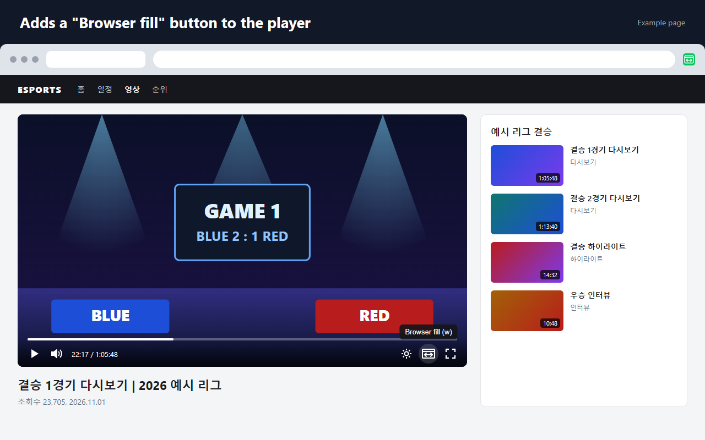
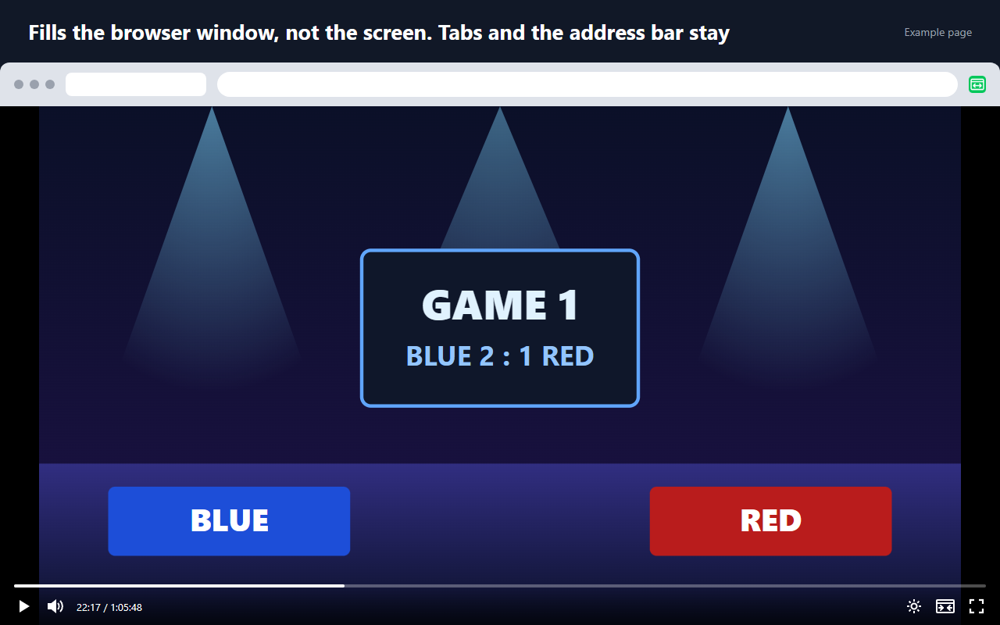

# Enhancer for NAVER Esports

[한국어](README.md) | **English**

A browser extension that enlarges the video player on NAVER Esports (`game.naver.com`) video pages to fill the browser window. It works in Chromium-based browsers such as Chrome, Edge and Whale.

Unlike fullscreen (the F key), the browser window, its tabs and the taskbar stay where they are: only the player inside the page grows to cover the window. The video keeps its aspect ratio, and any leftover space is shown as black bars. It is handy for watching while you switch between windows or tabs. The player's own play, seek, settings and fullscreen controls keep working while the player fills the window.

The extension's name, button and tooltips follow the browser's display language: Korean or English, and English for any other language. The Korean name is `Enhancer for NAVER e스포츠`.

## Screenshots



*The extension adds a **Browser fill** button to the player's control bar.*



*Turned on, the player fills the browser window while the tabs and address bar stay. The window is wider than 16:9, so the video keeps its aspect ratio with bars on both sides.*

Both images were taken with the real extension loaded in a browser, on an example page (`store/assets/demo-page.html`). The video, league and team names are made up; this is not the real site.

## Installation (load unpacked)

1. Open the browser's extension management page.

   | Browser | Address |
   | --- | --- |
   | Chrome | `chrome://extensions` |
   | Edge | `edge://extensions` |
   | Whale | `whale://extensions` |

   Other Chromium browsers load unpacked extensions the same way from their extension management page.
2. Turn on **Developer mode** (top right in Chrome, the left menu in Edge).
3. Click **Load unpacked** and select this repository's folder (the one containing `manifest.json`).
4. Reload any `game.naver.com` tab that was open before the installation.

## Usage

| Action | How |
| --- | --- |
| Toggle browser fill | The **Browser fill** button in the player's control bar (left of the fullscreen button) |
| Toggle browser fill | The `W` key on a video page (ignored while you type in a text field) |
| Toggle browser fill | Click the extension's toolbar icon, or press `Alt+Shift+W` |
| Turn browser fill off | `Esc` |

- The `W` key is matched by its physical position, so it works whatever the keyboard layout or input mode (for example, `ㅈ` in Korean Hangul mode).
- Change `Alt+Shift+W` from the shortcuts menu of the extension management page (`chrome://extensions/shortcuts` in Chrome). If the browser already uses that combination, the shortcut is left unassigned; set one there yourself.
- Once turned on, browser fill stays on in that tab as you move to another video or reload the page. Each tab remembers its own state, and turning browser fill off with `Esc` or the button ends it for that tab.
- The toolbar icon is enabled only on `game.naver.com`.

## How it works

`src/fill-mode.js` finds the largest video on the page and marks the NAVER PZP player element around it (`.pzp`) with a `data-ens-fill-target` attribute. A video without a player is marked itself. `src/content.css` pins the marked element to the viewport with `position: fixed`, and a `data-ens-fill-ancestor` attribute on every ancestor turns off properties that would trap a fixed element, such as `transform`, `filter` and `contain`. The same rule lifts the player above the site's fixed header (`z-index: 3001`). Turning browser fill off only removes the attributes, so the page returns to its original state, and the scroll position is restored.

After loading, the real site re-creates the player from its own HTML, which drops any event listener attached to an element. Button clicks are therefore handled by delegation from `window` (`installClickHandling` in `src/player-button.js`).

All text the extension shows lives in `_locales/en/messages.json` and `_locales/ko/messages.json`. `manifest.json` refers to it by message name, such as `__MSG_extName__`, and the content scripts read it through `chrome.i18n` via `src/i18n.js`. To add a language, create `_locales/<language code>/messages.json` with the same message names.

| File | Role |
| --- | --- |
| `manifest.json` | Manifest V3 configuration. The only permission is `declarativeContent` (the rule that enables the toolbar icon). |
| `_locales/` | English (`en`, the default) and Korean (`ko`) text |
| `src/i18n.js` | Text lookup for the content scripts |
| `src/fill-mode.js` | `FillController`, which manages the browser fill state |
| `src/player-button.js` | Creates the control-bar button, shows its state and handles clicks |
| `src/content.js` | Content script entry point: shortcuts, per-tab persistence, messages |
| `src/content.css` | Styles for browser fill and the button |
| `src/background.js` | Service worker: forwards toolbar icon clicks and `Alt+Shift+W` to the tab |

## Development

Requires Node.js 20 or later, and Microsoft Edge for the e2e tests.

```sh
npm install
npx playwright install chromium   # Chromium for the tests (once)
npm run lint
npm test              # unit tests + extension e2e tests (Chromium and Edge)
npm run test:live     # tests against the real game.naver.com page (Edge, needs network)
npm run icons         # regenerate the PNG icons after editing icons/icon.svg
npm run package       # build the store upload zip into dist/
npm run store-images  # regenerate the store screenshots and promo tile in store/images/
```

- **unit**: loads the content script modules into a plain page to test `FillController`, the button and the text lookup. Also checks that both languages' message files define the same messages.
- **e2e-chromium / e2e-edge**: load the unpacked extension into Chromium and Edge and serve local fixtures (`tests/fixtures/`) at `game.naver.com` addresses to test real usage. The browser's display language is switched between Korean, English and Japanese to check the text. No network access.
- **live**: checks that the player fills the window on a real video page. Run it to detect changes in the site's structure.

The Chromium that Playwright installs is the open-source base shared by Chrome, Whale and others. Release builds of Google Chrome no longer load extensions from the command line (`--load-extension`), which the test tool relies on, so the tests use this Chromium in place of Chrome.

## Store publishing

How to publish to the Chrome Web Store, the listing text to paste, the privacy practice answers and the screenshots are described in [`store/README.md`](store/README.md) (in Korean).

## Limitations

- Automated tests run only in Chromium and Edge. Chrome, Whale, Brave and others share the Chromium base, and the extension uses only standard Manifest V3 APIs, but it has not been checked in each of them directly.
- The extension depends on class names of the NAVER PZP player (`.pzp`, `.pzp-pc__bottom-buttons-right`, `.pzp-pc__fullscreen-button`). If the site changes its player, `npm run test:live` fails and the selectors need updating. Even when no player is found, the `W` key and the toolbar icon still fill the `<video>` element itself.
- The toolbar icon being enabled only on `game.naver.com` comes from the browser applying a `declarativeContent` rule, so automated tests can only check that the rule is registered.

## Trademark and disclaimer

This project is not affiliated with NAVER Corp., and the extension is not made or endorsed by NAVER. NAVER is a trademark of NAVER Corp. and is used in the name only to identify the site the extension works on.

The extension only changes how pages are displayed inside the user's browser. It does not download videos or block ads, and it collects and sends no data.

## License

[MIT](LICENSE)
