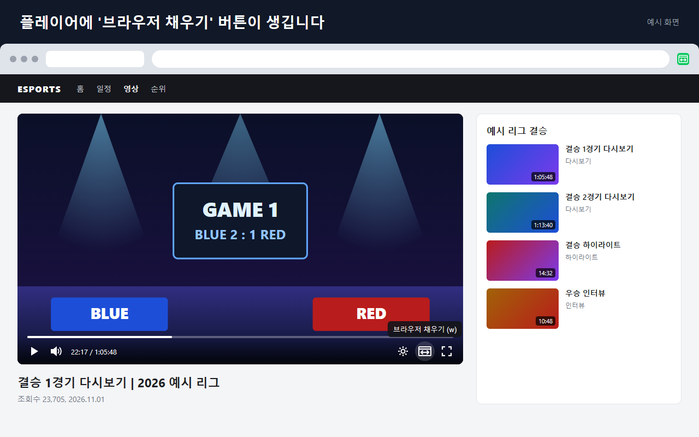
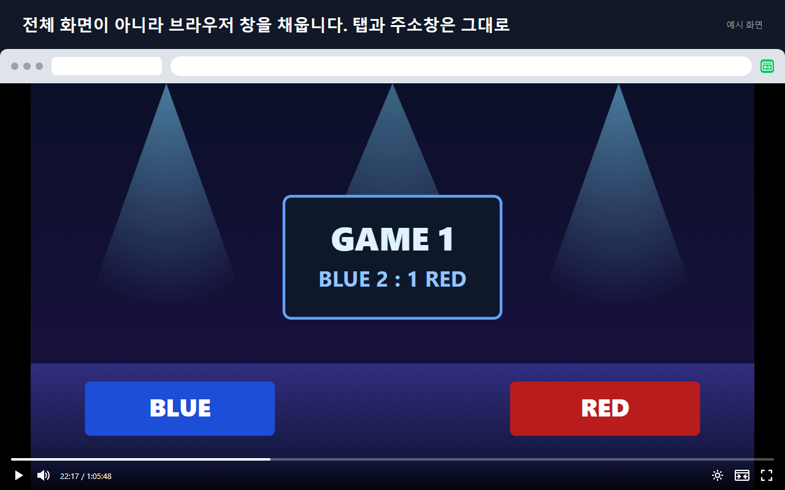

# Enhancer for NAVER e스포츠

**한국어** | [English](README.en.md)

네이버 e스포츠(`game.naver.com`) 영상 페이지의 플레이어를 브라우저 창 전체 크기로 키워 주는 브라우저 확장 프로그램입니다. Chrome, Edge, 웨일 같은 Chromium 기반 브라우저에서 동작합니다.

전체 화면(F 키)과 달리 브라우저 창, 탭, 작업 표시줄은 그대로 두고 페이지 안의 플레이어만 창 전체를 채웁니다. 영상은 원래 비율을 유지하고 남는 부분은 검은 여백으로 표시됩니다. 다른 창이나 탭을 오가며 볼 때 쓰기 좋습니다. 플레이어 자체의 재생, 탐색, 설정, 전체 화면 버튼은 채우기 상태에서도 그대로 동작합니다.

확장의 이름, 버튼, 툴팁은 브라우저의 표시 언어에 따라 한국어 또는 영어로 나옵니다. 그 밖의 언어에서는 영어로 표시됩니다. 영어 이름은 `Enhancer for NAVER Esports`입니다.

## 화면



*플레이어 컨트롤 바에 **브라우저 채우기** 버튼이 생깁니다.*



*켜면 탭과 주소창은 그대로 두고 플레이어가 브라우저 창을 채웁니다. 창이 16:9보다 넓어서 영상 좌우에 여백이 생기고, 영상은 원래 비율을 유지합니다.*

두 이미지는 실제 확장을 브라우저에 로드해 예시 페이지(`store/assets/demo-page.html`)에서 찍은 것입니다. 영상과 리그, 팀 이름은 지어낸 것이며 실제 사이트 화면이 아닙니다.

## 설치 (압축 해제된 확장 로드)

1. 브라우저의 확장 관리 화면을 엽니다.

   | 브라우저 | 주소 |
   | --- | --- |
   | Chrome | `chrome://extensions` |
   | Edge | `edge://extensions` |
   | 웨일 | `whale://extensions` |

   그 밖의 Chromium 브라우저도 확장 관리 화면에서 같은 방식으로 로드합니다.
2. **개발자 모드**를 켭니다 (Chrome은 오른쪽 위, Edge는 왼쪽 메뉴).
3. **압축해제된 확장 프로그램을 로드합니다**(Edge는 **압축 해제된 파일 로드**)를 눌러 이 저장소 폴더(`manifest.json`이 있는 폴더)를 선택합니다.
4. 확장을 설치하기 전에 열려 있던 `game.naver.com` 탭은 새로 고침해야 동작합니다.

## 사용법

| 동작 | 방법 |
| --- | --- |
| 채우기 켜기/끄기 | 플레이어 컨트롤 바의 **브라우저 채우기** 버튼 (전체 화면 버튼 왼쪽) |
| 채우기 켜기/끄기 | 영상 페이지에서 `W` 키 (입력창에 글을 쓰는 중에는 동작하지 않음) |
| 채우기 켜기/끄기 | 도구 모음의 확장 아이콘 클릭, 또는 `Alt+Shift+W` |
| 채우기 끄기 | `Esc` |

- `W` 키는 물리 키 기준이라 한/영 상태(한글 입력 시 `ㅈ`)와 상관없이 동작합니다.
- `Alt+Shift+W`는 확장 관리 화면의 단축키 메뉴(Chrome은 `chrome://extensions/shortcuts`)에서 바꿀 수 있습니다. 브라우저가 이미 같은 조합을 쓰고 있으면 단축키가 지정되지 않으니, 그때 직접 지정하면 됩니다.
- 채우기를 켠 탭에서는 다른 영상으로 이동하거나 새로 고침해도 채우기 상태가 유지됩니다. 상태는 탭마다 따로 기억되며, `Esc`나 버튼으로 끄면 그 탭에서 더 이상 유지되지 않습니다.
- 도구 모음 아이콘은 `game.naver.com`에서만 활성화됩니다.

## 동작 방식

`src/fill-mode.js`가 페이지에서 가장 큰 영상을 찾고, 그 영상을 감싼 네이버 PZP 플레이어 요소(`.pzp`)에 `data-ens-fill-target` 속성을 붙입니다. 플레이어가 없는 영상이면 `<video>` 요소 자체가 대상입니다. `src/content.css`는 이 요소를 `position: fixed`로 화면에 고정하고, 조상 요소 전체에 `data-ens-fill-ancestor` 속성을 붙여 `transform`, `filter`, `contain`처럼 고정 위치 요소를 가두는 속성을 해제합니다. 같은 규칙으로 사이트 상단의 고정 헤더(`z-index: 3001`)보다 위에 표시되게 합니다. 채우기를 끄면 속성만 지우므로 페이지가 원래 상태로 돌아가고, 스크롤 위치도 복원됩니다.

실제 사이트는 페이지를 연 뒤 플레이어를 자신의 HTML로부터 다시 만듭니다. 이때 요소에 직접 붙인 이벤트 리스너가 사라지므로, 버튼 클릭은 `window`에서 위임 방식으로 처리합니다(`src/player-button.js`의 `installClickHandling`).

화면에 보이는 문구는 모두 `_locales/en/messages.json`과 `_locales/ko/messages.json`에 있습니다. `manifest.json`은 `__MSG_extName__` 같은 이름으로 이 문구를 가리키고, 콘텐츠 스크립트는 `src/i18n.js`를 거쳐 `chrome.i18n`으로 읽습니다. 언어를 추가하려면 `_locales/<언어 코드>/messages.json`을 같은 메시지 이름으로 만들면 됩니다.

| 파일 | 역할 |
| --- | --- |
| `manifest.json` | Manifest V3 설정. 권한은 `declarativeContent`(아이콘 활성화 규칙)뿐입니다. |
| `_locales/` | 영어(`en`, 기본값)와 한국어(`ko`) 문구 |
| `src/i18n.js` | 콘텐츠 스크립트용 문구 조회 |
| `src/fill-mode.js` | 채우기 상태를 관리하는 `FillController` |
| `src/player-button.js` | 컨트롤 바 버튼 생성, 상태 표시, 클릭 처리 |
| `src/content.js` | 콘텐츠 스크립트 진입점: 단축키, 탭별 상태 유지, 메시지 처리 |
| `src/content.css` | 채우기 상태와 버튼 스타일 |
| `src/background.js` | 서비스 워커: 아이콘 클릭과 `Alt+Shift+W`를 탭에 전달 |

## 개발

Node.js 20 이상과, e2e 테스트용 Microsoft Edge가 필요합니다.

```sh
npm install
npx playwright install chromium   # 테스트용 Chromium (최초 1회)
npm run lint
npm test            # 단위 테스트 + 확장 e2e 테스트 (Chromium과 Edge)
npm run test:live   # 실제 game.naver.com 페이지 대상 테스트 (Edge, 네트워크 필요)
npm run icons       # icons/icon.svg 수정 후 PNG 아이콘 다시 생성
npm run package     # 스토어 업로드용 zip을 dist/에 생성
npm run store-images  # 스토어 스크린샷과 프로모션 타일을 store/images/에 다시 생성
```

- **unit**: 콘텐츠 스크립트 모듈을 일반 페이지에 넣어 `FillController`, 버튼, 문구 조회를 검증합니다. 두 언어의 메시지 파일이 같은 메시지를 모두 갖췄는지도 확인합니다.
- **e2e-chromium / e2e-edge**: 압축 해제된 확장을 Chromium과 Edge에 로드하고, `game.naver.com` 주소로 로컬 fixture(`tests/fixtures/`)를 제공해 실제 사용 흐름을 검증합니다. 브라우저 표시 언어를 한국어, 영어, 일본어로 바꿔 문구도 확인합니다. 네트워크를 쓰지 않습니다.
- **live**: 실제 영상 페이지에서 플레이어가 창 전체를 채우는지 확인합니다. 사이트 구조가 바뀌었는지 점검할 때 실행합니다.

Playwright가 함께 설치하는 Chromium은 Chrome, 웨일 등이 공통으로 쓰는 오픈 소스 기반입니다. Google Chrome 정식 버전은 테스트 도구가 쓰는 명령줄 방식(`--load-extension`)으로 확장을 로드하지 못하게 바뀌어서, Chrome 대신 이 Chromium으로 검증합니다.

## 스토어 배포

Chrome 웹 스토어에 올리는 방법, 붙여 넣을 설명 문구, 개인정보 탭 답변, 스크린샷은 [`store/README.md`](store/README.md)에 정리되어 있습니다.

## 제약

- 자동 테스트는 Chromium과 Edge에서만 실행합니다. Chrome, 웨일, Brave 등은 같은 Chromium 기반이고 이 확장은 Manifest V3 표준 API만 쓰지만, 각 브라우저에서 직접 확인하지는 않았습니다.
- 네이버 PZP 플레이어의 클래스 이름(`.pzp`, `.pzp-pc__bottom-buttons-right`, `.pzp-pc__fullscreen-button`)에 의존합니다. 사이트가 플레이어를 바꾸면 `npm run test:live`가 실패하며, 그때 선택자를 갱신해야 합니다. 플레이어를 찾지 못해도 `W` 키와 아이콘으로 `<video>` 자체를 채우는 동작은 남습니다.
- 도구 모음 아이콘이 `game.naver.com`에서만 켜지는 동작은 브라우저가 `declarativeContent` 규칙을 적용한 결과라 자동 테스트로는 규칙 등록까지만 확인합니다.

## 상표 및 면책

이 프로젝트는 네이버 주식회사(NAVER Corp.)와 관련이 없으며, 네이버가 만들거나 승인한 확장이 아닙니다. NAVER는 네이버 주식회사의 상표이고, 이 확장이 어느 사이트에서 동작하는지 알리기 위해서만 이름에 씁니다.

이 확장은 사용자의 브라우저 안에서 페이지의 표시 방식만 바꿉니다. 영상을 내려받거나 광고를 차단하지 않으며, 어떤 데이터도 수집하거나 외부로 보내지 않습니다.

## 라이선스

[MIT](LICENSE)
